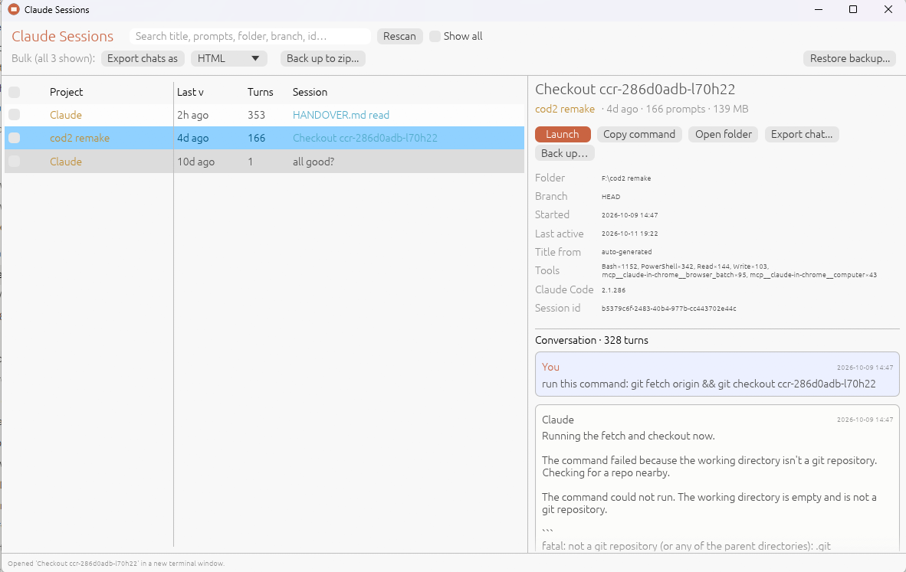

# claude-sessions

Find every Claude Code session on your computer, recognise each one at a glance,
relaunch it with a click, back sessions up, and export chats. Windows / macOS / Linux.

Unofficial community tool — not affiliated with or endorsed by Anthropic. It only
reads the transcript files Claude Code already keeps on your disk; nothing leaves
your machine.



```
dist/
  claude-sessions.exe              Windows GUI  (double-click)
  claude-sessions-cli.exe          Windows terminal picker
  claude-sessions-linux-x86_64     Linux GUI
  claude-sessions-cli-linux-x86_64 Linux terminal picker
claude_sessions.py                 original single-file Python picker (no deps)
rust/                              source for all of the above
```

All binaries are standalone (Rust, no runtime, only stock OS libraries).
`claude` must be on your PATH for launching to work.

## GUI

* **List** — project folder, last active, prompt count, and a recognisable
  title: the name you gave it with `/rename` (bold cyan) → Claude's auto title
  (cyan) → your first prompt. Branch shown when it isn't main/master.
  Green dot = that session is open right now. Click a column header to sort;
  type in the search box to filter on title, prompts, folder, branch or id.
* **Select a row** to see details and a preview of the whole conversation
  (your prompts, Claude's replies, tool calls). **Double-click** or **Launch**
  opens it in a new terminal window in its original folder
  (`cd <folder> && claude --resume <id>`). Windows uses Windows Terminal if
  installed, else a cmd window. **Copy command** / **Open folder** do what they say.
* **Export chat…** writes the conversation as **Markdown**, **HTML** (self-contained,
  styled, light/dark) or **JSON**. Tick several rows (or none = all shown) and use
  the *Bulk* row to export them all into a folder.
* **Back up…** zips the raw transcript (plus sub-agent sidechains) so the session
  can be **restored** later and resumed with `claude --resume`. *Bulk → Back up to
  zip…* does every checked/shown session; **Restore backup…** copies them back
  into `~/.claude` (never overwrites unless you tick the box). Useful before
  Claude Code's 30-day auto-cleanup, or to move sessions to another machine.

Windows notes: SmartScreen may warn the first time because the exe isn't code
signed — "More info → Run anyway". The exe honours `CLAUDE_CONFIG_DIR`.

## CLI

```
claude-sessions-cli                     interactive picker
  3        launch #3 in a new window      3 h   launch here      3 i   details
  3 e      export chat (md+html) to cwd   3 b   back up #3       B     back up all listed
  /text    filter                         r     rescan           q     quit
claude-sessions-cli --list | --json | -s TEXT | --all | --open ID_PREFIX
claude-sessions-cli --export html ./chats      export every listed chat
claude-sessions-cli --backup sessions.zip      back up every listed session
claude-sessions-cli --restore sessions.zip     restore (skips existing)
```

## Building

```
cd rust
cargo build --release                                 # native GUI + CLI
rustup target add x86_64-pc-windows-gnu               # Windows exes, from Linux:
sudo apt install mingw-w64
cargo build --release --target x86_64-pc-windows-gnu
```
On Windows with Rust installed, plain `cargo build --release` works too.
macOS: build natively; the launcher uses Terminal.app via osascript.

## Where it looks

```
$CLAUDE_CONFIG_DIR  or  ~/.claude  (%USERPROFILE%\.claude on Windows)
└── projects/<encoded cwd>/<session-id>.jsonl      ← one per session
                           <session-id>/subagents/ ← sidechains (backed up, not listed)
└── sessions/<pid>.json                            ← live registry → green dot
```

The real `cwd` is read from inside the transcript, never decoded from the folder
name. Backups mirror this layout under `projects/` with a `manifest.json`.

## Caveats

* The transcript entry format is internal to Claude Code and can change between
  releases. The fields used (`type`, `sessionId`, `cwd`, `timestamp`,
  `isSidechain`, `gitBranch`, `message.content`) were verified against 2.1.300.
  Auto-generated titles are confirmed working on 2.1.286+; `/rename` names are
  matched by several plausible spellings — if a renamed session shows its first
  prompt instead, please open an issue with one (redacted) line from the transcript.
* Claude Code deletes sessions older than `cleanupPeriodDays` (default 30); the
  tool can only list what's still on disk — hence the backup feature.

## License

MIT. Built with [egui](https://github.com/emilk/egui) (MIT/Apache-2.0).
